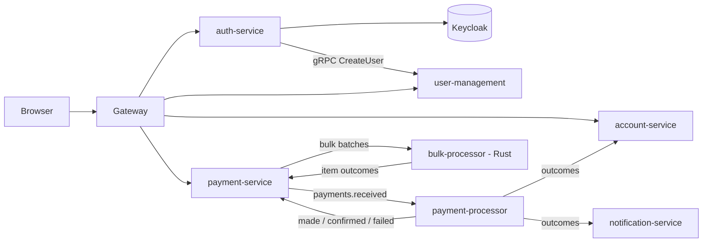

# 💳 Payment Platform

A learning project: an event-driven payments platform built as a set of independently deployable microservices. Customers make single payments or upload a CSV of bulk payments; the platform validates them, processes them asynchronously over Kafka against mock payment rails (RTC, STP, EFT), updates account balances, and keeps the user informed with live progress and email notifications.

## 🎯 What I'm Trying to Achieve

The goal is to practise the patterns a real payments backend needs, end to end, rather than a CRUD app:

- **Reliable messaging without distributed transactions.** Every service that publishes writes its business change and an *outbox* row in one local transaction; a relay publishes the row to Kafka. Delivery is at-least-once, so every consumer deduplicates through an *inbox* table in the same transaction as its effect.
- **Microservice boundaries that are actually independent.** The repo is a monorepo for organisation only: each service has its own build, Dockerfile and Postgres database, with no shared code. Services talk over the network only: gRPC for synchronous calls, Kafka for events. Each producer owns its contracts.
- **Payments-shaped problems.** Payment status tracking, compensating events instead of rollbacks, bulk batches where invalid rows are flagged and valid ones continue, failed items recorded and never silently reprocessed, and live progress over SSE.
- **Real authentication.** Keycloak issues tokens and manages users; the gateway validates every request; platform users are linked to Keycloak by the Keycloak user id.
- **A polyglot service.** Bulk batches are processed by a Rust service (tokio, rdkafka, sqlx) that implements its own inbox and outbox.

## 🏗️ How It Works



- **Gateway** is the only entry point. It validates Keycloak tokens (realm JWKS); `/api/auth/**` is public, everything else needs a bearer token.
- **Sign-up:** auth-service creates the user in Keycloak, then calls user-management `CreateUser` synchronously over gRPC with the Keycloak user id. If that fails, the Keycloak user is deleted again so the sign-up can be retried.
- **Single payment:** payment-service validates the request and writes the payment and an outbox row in one transaction → `payments.received` → payment-processor-service calls the mock rail → `PaymentMade` / `PaymentConfirmed` / `PaymentFailed` → payment-service updates status and pushes SSE updates; account-service applies debits/credits; notification-service sends email.
- **Bulk payment:** the customer uploads a CSV → payment-service validates it, flags invalid rows (editable on a review screen), and publishes the batch for the Rust bulk-processor, keyed by batch id so items in a batch stay in order.
- **Fraud (optional):** fraud-service can gate a payment before it enters processing.

Roles are `customer` and `admin`.

## 📊 Status

| Area | State |
|---|---|
| Auth: Keycloak realm, gateway token validation, login / refresh / sign-up, internal `GetUser` / `ListUsers` | built |
| user-management `CreateUser` (keyed by Keycloak user id) | built |
| Bulk CSV upload endpoint with file validation | built (row validation and batch processing next) |
| Outbox relays, Kafka consumers / inboxes | scaffolded (tables and packages) |
| Single payments, mock rails, accounts, notifications, fraud | to do |
| Rust bulk-processor | scaffolded |
| Frontend | not started |

Bulk payments are being built first.

## 📂 Repository Structure
```
services/
  gateway/                   Spring Cloud Gateway (WebFlux), edge auth          :8080
  auth-service/              thin Keycloak wrapper, gRPC client + server        :8081 / gRPC 9081
  user-management-service/   user record, roles, admin ops; outbox              :8082 / gRPC 9082
  account-service/           accounts, debits/credits; outbox + inbox           :8083 / gRPC 9083
  payment-service/           client payments API, bulk CSV, SSE; outbox + inbox :8084
  payment-processor-service/ rails (mock), no public API; outbox + inbox        :8085
  notification-service/      email; inbox                                       :8086
  fraud-service/             optional fraud gate; outbox + inbox                :8087
  bulk-processor/            Rust (cargo); inbox + outbox
infra/                       Postgres init + replica, Kafka topics, Keycloak realm
frontend/                    placeholder
docker-compose.yml           the whole local stack
```

Each producer owns its contracts in `services/<service>/contracts/`. A consumer copies the file into its own `src/main/protobuf/` (never imports it).

## 🛠️ Tech Stack

* **Java:** 25
* **Framework:** Spring Boot 4.1.1, Spring Cloud Gateway (Spring Cloud 2025.1.3), Spring gRPC, Spring for Apache Kafka, Spring Data JPA
* **Messaging:** Apache Kafka 4.3 (KRaft)
* **Database:** PostgreSQL 18 (primary + async streaming replica), Flyway
* **Auth:** Keycloak 26.7
* **Bulk processor:** Rust 2024 edition (tokio, rdkafka, sqlx)
* **Build Tool:** Maven per service (root `pom.xml` is an aggregator only), Cargo
* **Containerization:** Docker, Docker Compose
* **Local email:** Mailpit
* **CI/CD:** GitHub Actions (one workflow per service, path-filtered)

## 🐳 Run Locally
```bash
cp .env.example .env
```

Keycloak imports the `payments` realm (`infra/keycloak/realms/payments-realm.json`) on first start, and Postgres creates the `keycloak` database only when its volume is new. If your Postgres volume was created before the `keycloak` database existed, reset it once with `docker compose down -v`.

Infra only (run the services from your IDE or `mvn spring-boot:run` / `cargo run`):
```bash
docker compose up -d postgres postgres-replica kafka kafka-init keycloak mailpit
```

Everything, built from source:
```bash
docker compose up -d --build
```

Add the optional fraud-service with `--profile fraud`.

### 🌍 Configuration
- `application.yaml` holds shared config. Every environment-specific value (database, Kafka, gRPC targets, Keycloak, mail) is an env var with no default, so a non-local deployment must supply it.
- `application-local.yaml` holds the local values, addressed by compose network hostnames (`postgres`, `kafka`, `keycloak`, `<service>:<port>`). Compose runs every Spring service with `SPRING_PROFILES_ACTIVE=local`.
- bulk-processor reads `services/bulk-processor/.env.local` (compose `env_file`, and `dotenvy` for `cargo run`).
- Running a service from the IDE against the compose infra: use the `local` profile and override hosts with env vars, e.g. `SPRING_DATASOURCE_URL=jdbc:postgresql://localhost:5432/payment`, `SPRING_KAFKA_BOOTSTRAP_SERVERS=localhost:9092`.

Ports are the same everywhere (host and compose network); only the gateway is published to the host.

| Service | HTTP | gRPC |
|---|---|---|
| gateway | 8080 | |
| auth-service | 8081 | 9081 |
| user-management-service | 8082 | 9082 |
| account-service | 8083 | 9083 |
| payment-service | 8084 | |
| payment-processor-service | 8085 | |
| notification-service | 8086 | |
| fraud-service | 8087 | |

### 🔌 External REST APIs
auth-service calls Keycloak over REST (no admin-client SDK): `app.keycloak.base-url` (local `http://keycloak:8180`), realm `payments`, confidential client `auth-service`. The gateway validates tokens against the realm JWKS (`KEYCLOAK_JWKS_URI`).

Gateway routes are under `spring.cloud.gateway.server.webflux.routes`: `/api/auth/**`, `/api/users/**`, `/api/accounts/**`, `/api/payments/**`. Base config takes each target from an env var (`AUTH_SERVICE_URI`, `USER_MANAGEMENT_SERVICE_URI`, `ACCOUNT_SERVICE_URI`, `PAYMENT_SERVICE_URI`); the local profile defaults them to the compose hostnames.

| Endpoint | URL |
|---|---|
| Gateway | http://localhost:8080 |
| Keycloak (admin console: admin / `KEYCLOAK_ADMIN_PASSWORD`) | http://localhost:8180 |
| Postgres primary / replica | localhost:5432 / localhost:5433 |
| Kafka | localhost:9092 |
| Mailpit UI | http://localhost:8025 |

## ⚙️ Build One Service
```bash
cd services/payment-service && mvn verify
```

```bash
cd services/bulk-processor && cargo build
```

CI runs one workflow per service, triggered only by changes under that service's folder (`.github/workflows/`).

## 🔨 Tools Used
[](https://skillicons.dev)
